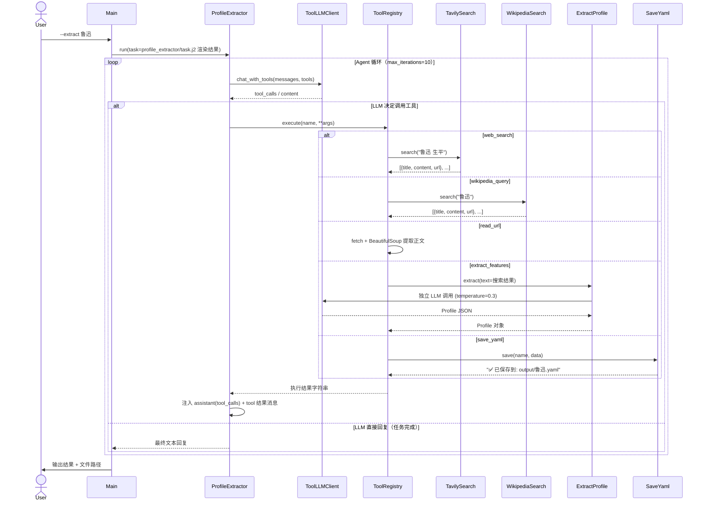

# 实验 4：人物特征提取与工具调用

> 对应章节 2.3 自动构建：特征提取与工具调用 ｜ 4 学时 ｜ ✅ 已完成

## 概述

实验 2 的角色定义（`luxun.yaml`）是手工编写的。对于一个不太熟悉的人物，需要查阅大量资料再逐字段填写——这是一件费时费力的事。

本实验让智能体**自己上网搜索资料、自动提取特征、生成角色 YAML**：

- **搜索工具**：Tavily Search API（专为 AI Agent 优化的搜索） + Wikipedia API（免费、权威的百科摘要）
- **特征提取工具**：LLM 分析搜索结果，输出结构化的 `Profile`
- **网页读取工具**：抓取指定 URL 正文，深入阅读
- **Tool Registry 框架**：手动实现 OpenAI Function Calling 流程，不依赖 LangChain
- **Agent 循环**：LLM 自主决定何时调用工具、如何处理结果，多工具链式协作
- **错误处理**：工具层面 `@retry` 自动重试网络故障，Agent 层面 LLM 自主判断工具返回的错误并调整策略
- **提示词增强**：`profile_extractor/system.j2` 内置 CoT 推理引导（四步决策链），`profile_extractor/task.j2` 包含 `few_shot_examples` 字段的 Few-shot 格式指南

一句话概括：**"帮我创建鲁迅的角色定义" → Agent 自动搜索 → 提取 → 校验 → 输出 YAML**。

## 功能清单

| 功能 | 命令                                  | 说明 |
|------|-------------------------------------|------|
| 自动提取 | `python main.py --extract 鲁迅`       | 搜索 + 提取 + 保存，全自动生成角色 YAML |
| 测试搜索 | `python main.py --search 鲁迅 生平`     | 单独测试 Tavily 搜索 |
| 列出工具 | `python main.py --list-tools`       | 查看所有已注册工具及其参数 |
| 评估提取质量 | `python main.py --eval luxun`       | LLM-as-Judge 对比参考 YAML，8 方面 × 2 维度评分 |

## 文件结构

```
03-tool-calling/
├── config.yaml               # LLM + Tavily 配置
├── config.yaml.example       # 配置参照文件
├── requirements.txt          # 实验依赖（openai / PyYAML / pydantic / jinja2 / requests / beautifulsoup4 / lxml）
│
├── data/                     # 数据文件
│   ├── profiles/           #   手工参考角色 YAML（从 01-prompt-design 继承）
│   │   └── luxun.yaml
│   ├── memories/            #   记忆数据（从 02-memory 继承）
│   │   └── .gitkeep
│   └── eval/                 #   提取质量评估数据
│       └── test_questions.json  #   8 个评估方面
│
├── prompts/                  # Jinja2 提示词模板
│   ├── eval.j2               #   提取质量 LLM-as-Judge 评估模板
│   ├── memory/               #   记忆相关模板（从 02-memory 继承）
│   │   └── conversation/
│   │       ├── compression.j2
│   │       └── summary.j2
│   └── agents/               #   ★ Agent 专用 prompt
│       └── role_play/        #     与代码包路径对齐
│           ├── profile_extractor/
│           │   ├── system.j2     #     Agent 循环的行为准则（含 CoT 四步推理引导）
│           │   └── task.j2       #     特征提取任务描述（含 Few-shot 格式指南 + 示例模板）
│           └── tools/
│               └── extract_profile/
│                   └── system.j2  #     ExtractProfile 的提取规则
│
├── src/                      # 核心代码
│   ├── main.py               #   CLI 入口（--extract / --search / --list-tools / --eval）
│   ├── config.py             #   Pydantic v2 配置（新增 TavilyConfig）
│   ├── evaluator.py          #   提取质量评估器（8 方面 × 2 维度）
│   ├── agents/               #   ★ Agent 实现（按角色组织）
│   │   └── role_play/        #     角色扮演 Agent
│   │       ├── profile_extractor.py    #     ProfileExtractor — Agent 循环
│   │       ├── models/               #     数据模型
│   │       │   └── profile.py         #  Profile Pydantic 模型
│   │       └── tools/                #     Agent 专属工具
│   │           └── extract_profile.py #  从文本提取 Profile 工具
│   ├── llm/                  #   LLM 调用封装
│   │   ├── client.py         #     基础 LLM 客户端（本实验独立模块）
│   │   ├── tool_client.py    #     ★ 支持 Function Calling 的 LLM 客户端
│   │   └── tool_registry.py  #     ★ Tool Registry（注册 / Schema 生成 / 执行）
│   ├── tools/                #   ★ 通用工具实现
│   │   ├── tavily_search.py  #     Tavily Web Search
│   │   ├── wikipedia_search.py #   Wikipedia 百科查询
│   │   ├── read_url.py       #     网页内容读取（BeautifulSoup）
│   │   └── save_yaml.py      #     YAML 保存（dict → YAML 写入）
│   ├── inherit/              #   从 02-memory 继承的模块（llm / prompt / memory / utils）
│   └── utils/                #   本实验新增工具
│       ├── retry.py          #     @retry 重试装饰器
│       └── model_render.py   #     Pydantic 模型 → 代码字符串生成
│
└── output/                   # 自动生成的角色 YAML 输出
    └── .gitkeep
```

> **从上一章迁移的代码**：`src/inherit/` 目录下的 `prompt/prompt_manager.py`、`utils/path.py` 等均直接继承自 `02-memory`，无需修改。`src/llm/client.py` 为本实验独立模块。新增核心模块按角色组织在 `src/agents/role_play/` 下（Agent 循环、数据模型、专属工具），通用工具保留在 `src/tools/`。

## 架构总览

`--extract` 走 Agent 循环——LLM 通过 Function Calling 自主决定工具调用序列。



> **关键**：不是代码写死"先搜 5 次再提取再保存"，而是 **LLM 通过 Function Calling 自主决定**工具调用序列——搜什么、搜几次、何时提取、何时保存。

## 快速开始

### 1. 安装依赖

```bash
cd ch02-role-agent/03-tool-calling
pip install -r requirements.txt
```

### 2. 配置 LLM 和 Tavily Search

```bash
cp config.yaml.example config.yaml
# 编辑 config.yaml，填入：
#   - llm.api_key_env: DeepSeek API Key
#   - tavily.api_key: Tavily Search API Key（https://tavily.com 注册，免费 1000 次/月）
```

### 3. 运行

```bash
# 列出可用工具
python main.py --list-tools

# 单独测试 Tavily 搜索
python main.py --search 鲁迅 生平 性格

# 自动提取角色定义（核心功能）
python main.py --extract 鲁迅

# 评估提取质量（对比手工参考 YAML）
python main.py --eval luxun
```

## 工具详情

| 工具 | Function Calling name | 参数 | 说明 |
|------|----------------------|------|------|
| Tavily 搜索 | `web_search` | `query`（必填）, `max_results` | 专为 AI Agent 优化的搜索 API |
| Wikipedia | `wikipedia_query` | `query`（必填）, `max_results` | 免费、权威的百科摘要 |
| 网页读取 | `read_url` | `url`（必填） | 抓取网页正文并提取可见文本 |
| 特征提取 | `extract_features` | `text`（必填） | LLM 分析文本 → `Profile` JSON |
| YAML 保存 | `save_yaml` | `name`（必填）, `data`（必填） | Pydantic 校验 → 序列化为 YAML |

## 核心技术要点

### 1. ToolDef + ToolRegistry — 工具注册与 Schema 生成

```python
@dataclass
class ToolDef:
    name: str              # 工具名（LLM 通过此名调用）
    description: str       # 功能描述（帮助 LLM 理解何时使用）
    parameters: dict       # JSON Schema 参数定义
    func: Callable         # 实际可调用对象
    required: list[str]    # 必填参数列表

    def to_openai_tool(self) -> ChatCompletionToolParam:
        """转为 OpenAI Function Calling 的 tool 格式"""
```

每个工具类（如 `TavilySearch`）暴露 `to_tool_def()` 方法，返回 `ToolDef` 对象，统一注册到 `ToolRegistry`。

### 2. Agent 循环 — while not finished

```python
class ProfileExtractor:
    def run(self, task: str) -> str:
        messages = [system_prompt, user_task]
        tools = [t.to_openai_tool() for t in registry.list()]

        for iteration in range(1, max_iterations + 1):
            content, tool_calls = llm.chat_with_tools(messages, tools)

            if not tool_calls:      # 无工具调用 → 任务完成
                return content

            for tc in tool_calls:   # 有工具调用 → 逐个执行
                result = registry.execute(tc.function.name, **args)
                # 注入 assistant(tool_calls) + tool result 消息
```

### 3. 错误处理 — 双层设计

| 层级 | 机制 | 处理对象 |
|------|------|----------|
| 工具层 | `@retry(max_retries=3, delay_s=2.0)` | 网络抖动、API 限流等瞬时故障 |
| Agent 层 | LLM 自主判断工具返回的 `error` / `message` 键 | 搜索无结果、提取失败等业务异常 |

工具层重试对 LLM 透明——只有重试全部失败后，LLM 才看到错误字符串并自行决定下一步（如换关键词重搜、跳过该工具等）。

## 与前后实验的关系

```
实验 2（01-prompt-design）   实验 3（02-memory）      实验 4（03-tool-calling）
─────────────────────────  ───────────────────────  ─────────────────────────────
手工编写角色 YAML           短期 + 长期记忆           ★ 自动搜索 + 提取 + 生成 YAML
Jinja2 模板渲染             滑动窗口 + 摘要压缩       Function Calling + Agent 循环
LLM-as-Judge 四维评估       混合检索 + 时间衰减       Tool Registry + 多工具协作
                                                                  ↓
                                                    实验 5（04-integration）
                                                    整合提示词 + 记忆 + 工具 + TTS
```

## 扩展方向

- [ ] 添加更多搜索源（百度百科爬虫、Bing API）
- [ ] 搜索结果的置信度评估与过滤
- [ ] 多轮搜索优化（第一轮结果不够 → 自动细化关键词）
- [ ] 支持批量提取（从名单文件读取多个人物）
- [ ] 支持增量更新（已有 YAML → 补充缺失字段）
