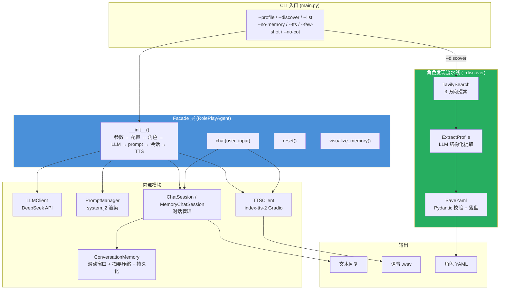
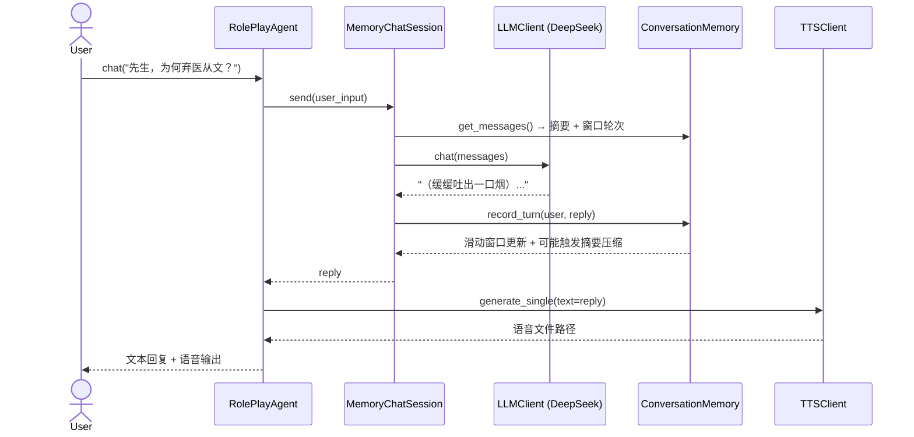
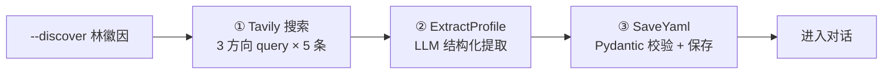

# 实验 5：角色模拟智能体综合实践

> 对应章节 2.4 实战：角色模拟智能体 ｜ 2 学时 ｜ ✅ 已完成

## 概述

在前三个实验中，我们分别实现了**提示词设计**（实验 2）、**记忆系统**（实验 3）、**工具调用与自动提取**（实验 4）。每个模块都能独立运行，但它们是分散的——学生需要手动拼接才能体验一个"完整"的角色模拟智能体。

本实验将这些模块**统一整合**为一个系统，通过 **Facade 模式**对外暴露极简 API：

```python
agent = RolePlayAgent(profile_name="luxun", llm=llm, enable_memory=True)
reply = agent.chat("先生，您当年为什么决定弃医从文？")
```

同时新增三个能力：

- **--discover 自动角色发现**：一句话创建新角色（搜索 → 提取 → 保存 → 对话），将实验 4 的工具调用能力直接集成到对话入口
- **TTS 语音输出**：集成 index-tts-2，将角色回复合成为语音（支持音色克隆与情感控制）
- **智能体评估与自我反思**：从风格一致性、对话流畅性、记忆准确性等维度评估系统表现，并通过自我反思机制发现问题、优化提示词

## 功能清单

| 功能 | 命令 | 说明 |
|------|------|------|
| 交互式对话 | `python main.py --profile luxun` | 完整角色模拟（提示词 + 记忆 + CoT） |
| 列出角色 | `python main.py --list` | 扫描 `data/profiles/` 目录 |
| 自动发现角色 | `python main.py --discover 林徽因` | 搜索 + 提取 + 保存 → 对话 |
| 关闭记忆 | `python main.py --profile luxun --no-memory` | 仅对话，无短期/长期记忆 |
| 启用 TTS | `python main.py --profile luxun --tts` | 语音合成输出 |
| Few-shot | `python main.py --profile luxun --few-shot` | 注入 Few-shot 对话示例 |
| 关闭 CoT | `python main.py --profile luxun --no-cot` | 移除 CoT 思考链引导 |
| 对话内命令 | `/quit` `/reset` `/memory` | 退出 / 重置 / 记忆面板 |

## 文件结构

```
04-integration/
├── config.yaml               # 完整配置（LLM + 生成 + 记忆 + Tavily + TTS）
├── config.yaml.example       # 配置参照文件
├── requirements.txt          # 实验依赖
│
├── data/                     # 数据文件
│   ├── profiles/             #   角色 Profile（含手工编写 + --discover 自动生成）
│   │   └── luxun.yaml        #     鲁迅（示例）
│   └── memories/             #   记忆持久化（按 session_id 分文件）
│
├── prompts/                  # Jinja2 提示词模板（从 02/03 继承）
│   ├── agents/               #   按模块组织的 prompt
│   │   └── role_play/
│   │       ├── role_play_agent/
│   │       │   └── system.j2 #   角色 system prompt（含 CoT、Few-shot 条件渲染）
│   │       ├── profile_extractor/
│   │       └── tools/
│   ├── eval.j2               #   评估 prompt
│   └── memory/
│       └── conversation/
│           ├── compression.j2  #   摘要压缩模板
│           └── summary.j2      #   长期记忆摘要模板
│
├── src/                      # 核心代码（工作目录）
│   ├── main.py               #   CLI 入口（--profile / --discover / --list 等）
│   ├── config.py             #   Pydantic v2 配置（LLM / 生成 / 记忆 / Tavily / TTS）
│   ├── agents/role_play/     #   ★ Facade 统一入口
│   │   └── role_play_agent.py #   RolePlayAgent：组装所有模块
│   ├── tts/                  #   ★ 语音合成
│   │   └── client.py         #     TTSClient：封装 index-tts-2 Gradio 服务
│   └── inherit/              #   从 03-tool-calling 继承的模块（完整复用）
│       ├── llm/              #     LLMClient / ToolLLMClient / ChatSession / MemoryChatSession
│       ├── memory/           #     ConversationMemory（滑动窗口 + 摘要压缩 + 持久化）
│       ├── prompt/           #     PromptManager（Jinja2 渲染）
│       ├── agents/role_play/models/  #   Profile（Pydantic v2 数据模型）
│       ├── agent/            #     ToolCallingAgent（Agent 循环）
│       ├── tools/            #     5 个工具（搜索 / 百科 / 网页 / 提取 / 保存）
│       └── utils/            #     retry / path / model_render
│
└── tests/                    # 自动化测试
    └── test_cli.py           #   10 个 CLI 回归测试用例
```

> **本实验新增文件**：`src/agents/role_play/role_play_agent.py`、`src/tts/client.py`、`src/main.py`、`src/config.py`（扩展 TTSConfig）、`tests/test_cli.py`。其余全部从 03-tool-calling 继承。

## 架构总览



> **Facade 模式的核心价值**：调用方不需要知道内部有多少模块、如何组装——只需 `RolePlayAgent(profile_name="luxun", llm=llm)` 然后 `.chat()`。

## 快速开始

### 1. 安装依赖

```bash
cd ch02-role-agent/04-integration
pip install -r requirements.txt
```

### 2. 配置

```bash
cp config.yaml.example config.yaml
# 编辑 config.yaml，填入：
#   - llm.api_key_env: DeepSeek API Key
#   - tavily.api_key: Tavily Search API Key（用于 --discover）
#   - tts: 可选，需启动 index-tts-2 服务
```

### 3. 运行

```bash
# 工作目录切换到 src/
cd src

# 列出可用角色
python main.py --list

# 交互式对话（默认鲁迅 + 记忆 + CoT）
python main.py --profile luxun

# 自动发现新角色（搜索 → 提取 → 保存 → 对话）
python main.py --discover 林徽因

# 关闭记忆的纯对话
python main.py --profile luxun --no-memory

# 启用 TTS 语音输出（需先启动 index-tts-2 服务）
python main.py --profile luxun --tts
```

## 命令行参数

| 参数 | 类型 | 说明 |
|------|------|------|
| `--profile NAME` | str | 角色名称（不含 `.yaml`），如 `luxun` |
| `--discover NAME` | str | 自动搜索提炼新角色并进入对话 |
| `--list` | flag | 列出 `data/profiles/` 下所有角色 |
| `--no-memory` | flag | 关闭短期 + 长期记忆 |
| `--tts` | flag | 启用 TTS 语音输出 |
| `--few-shot` | flag | 在 system prompt 中注入 Few-shot 示例 |
| `--no-cot` | flag | 关闭 CoT 思考链引导 |

对话内命令：

| 命令 | 说明 |
|------|------|
| `/quit` | 退出对话 |
| `/reset` | 重置对话历史（不清除持久化记忆文件） |
| `/memory` | 查看记忆面板（滑动窗口 + 摘要 + 统计） |

## 核心技术要点

### 1. Facade 模式 — 模块组装

`RolePlayAgent` 是统一的外观入口，在 `__init__()` 中完成全部模块的初始化与组装：

```python
class RolePlayAgent:
    def __init__(self, profile_name, llm, enable_memory=True,
                 enable_cot=True, enable_few_shot=False,
                 max_turns=20, max_tokens=3000,
                 tts_client=None, tts_voice_ref_path=None):
        # 1. 加载角色 Profile（YAML → Profile）
        self._profile = Profile.from_yaml(
            data/profiles / f"{profile_name}.yaml"
        )

        # 2. 注入 LLM 客户端（构造方传入，不再自行创建）
        self._llm = llm

        # 3. 初始化 PromptManager
        self._pm = PromptManager(prompts/)

        # 4. 渲染 system prompt（system.j2）
        self._system_prompt = self._pm.render(
            "agents/role_play/role_play_agent/system.j2",
            profile=self._profile, ...
        )

        # 5. 创建会话（记忆 / 无记忆）
        if enable_memory:
            memory = ConversationMemory(
                storage_dir=data/memories/,
                session_id=profile_name,
                max_turns=max_turns, max_tokens=max_tokens, ...
            )
            self._session = MemoryChatSession(llm, system_prompt, memory)
        else:
            self._session = ChatSession(llm, system_prompt)

        # 6. 注入 TTS（可选，构造方传入）
        self._tts = tts_client
        self._tts_voice_ref_path = tts_voice_ref_path

    def chat(self, user_input: str) -> str:
        reply = self._session.send(user_input)
        if self._tts is not None:
            output_path = self._synthesize_speech(reply)
            if output_path:
                self._play_audio(output_path)   # 自动播放
        return reply
```

**模块协作关系**（Mermaid 时序图）：



### 2. --discover 自动角色发现

将实验 4 的 Agent 循环简化为**直接流水线**（Direct Pipeline），固定三步：



```python
_SEARCH_QUERIES = [
    "{name} 生平 性格 代表作品",
    "{name} 说话风格 语言特点 轶事",
    "{name} 思想 情感 人际关系",
]

def discover_profile(name, cfg):
    # 1. 搜索（3 方向 × 5 条 = 15 条资料）
    search = TavilySearch(api_key=cfg.tavily.api_key)
    all_results = []
    for query_template in _SEARCH_QUERIES:
        results = search.search(query_template.format(name=name))
        all_results.extend(results)

    # 2. 提取（temperature=0.3，追求准确）
    extract_llm = ToolLLMClient(temperature=0.3)
    extractor = ExtractProfile(extract_llm, pm)
    profile = extractor.extract(json.dumps(all_results))

    # 3. 保存（Pydantic 校验后写入 YAML）
    saver = SaveYaml(profiles_dir)
    saver.save(name=name, data=profile.model_dump())
```

终端运行效果：

```bash
$ python main.py --discover 林徽因

🔍 正在搜索 林徽因 的资料...
  📡 林徽因 生平 性格 代表作品: 5 条
  📡 林徽因 说话风格 语言特点 轶事: 5 条
  📡 林徽因 思想 情感 人际关系: 5 条
  共获取 15 条有效资料，开始提取特征...

✅ 已保存到: data/profiles/林徽因.yaml
  身份: 中国现代建筑学奠基人之一、建筑学家、文学家
  性格: 独立清醒、理性智慧、坚韧执着
  Few-shot 示例: 2 组

============================================================
  🎭 角色模拟智能体综合实践 — 林徽因
============================================================
```

### 3. TTS 语音合成

集成 **index-tts-2**，通过 Gradio 客户端调用：

```python
class TTSClient:
    def __init__(self, base_url: str):
        self.client = Client(base_url)  # Gradio 客户端

    @retry(max_retries=3, delay_s=2)
    def generate_single(self, output_path, text, voice_ref_path,
                        emo_control_method, emotion_vectors, ...):
        """调用 /gen_single 接口生成语音"""
        result = self.client.predict(
            text=text,
            voice_ref=handle_file(voice_ref_path),
            ...
        )
        shutil.copy(result, output_path)
```

**TTS 配置**（`config.yaml`）：

```yaml
tts:
  base_url: "http://127.0.0.1:7860"    # index-tts-2 Gradio 服务地址
  voice_ref_path: ""                    # 声音参考音频路径（用于音色克隆）
```

**index-tts-2 服务搭建**：

本实验使用的 index-tts-2 镜像地址：  
`https://featurize.cn/images/ab87a150-d29d-46f1-aad8-028c30ae3a80`

成功创建实例后，在终端执行启动脚本：

```bash
./launch_index_tts.sh
```

服务启动后，控制台会输出 Gradio 公网地址（形如 `http://workspace.featurize.cn:28618`），将该地址填入 `config.yaml` 中的 `tts.base_url` 即可完成 TTS 配置。

**情感控制**：支持 8 维情感向量（开心/生气/悲伤/害怕/厌恶/忧郁/惊讶/平静），可按需调整角色语音的情绪表达。

语音合成在 `chat()` 中自动触发——每次 LLM 回复后异步生成 `.wav` 文件，不阻塞对话流程。

### 4. 配置体系

```python
class Config(BaseModel):
    llm: LLMConfig           # API 密钥、地址、模型
    generation: GenerationConfig  # temperature / top_p / max_tokens
    memory: MemoryConfig     # max_turns / max_tokens（压缩阈值）
    tavily: TavilyConfig     # Tavily API Key / max_results
    tts: TTSConfig           # TTS 服务地址 / 音色参考
```

所有配置集中在 `config.yaml` 中，通过 `Config.from_yaml()` 一次性加载，Pydantic v2 自动校验类型和完整性。

### 5. 智能体评估方法

评估从以下维度量化角色模拟质量：

| 维度 | 评估内容 | 方法 |
|------|----------|------|
| **风格一致性** | 回复是否符合角色的语调、用词、时代感 | LLM-as-Judge 对比角色 YAML |
| **对话流畅性** | 多轮对话是否连贯、上下文是否衔接 | 连续 N 轮自动对话 + 人工抽检 |
| **记忆准确性** | 是否记住用户说过的事实、是否有幻觉 | 事实注入 → N 轮后追问 → 对比 |
| **功能完整性** | 各模块开关组合是否正常工作 | 自动化 CLI 测试（10 用例） |

评估结果用于驱动**自我反思**：分析低分维度 → 定位根因（如 prompt 指令不够清晰、记忆窗口太小导致遗忘）→ 调整对应参数 → 重新测试验证。

---

## 自动化测试

```bash
python tests/test_cli.py
```

10 个测试用例覆盖：

| 用例 | 验证内容 |
|------|----------|
| `help` | 所有命令行参数正确列出 |
| `list` | 角色列表包含 luxun |
| `missing_profile` | 缺少 --profile 时有错误提示 |
| `invalid_profile` | 不存在的角色报错 |
| `basic_chat` | 基本对话功能正常 |
| `no_memory` | --no-memory 关闭记忆 |
| `no_cot` | --no-cot 关闭 CoT |
| `few_shot` | --few-shot 启用 Few-shot |
| `memory_panel` | /memory 显示记忆面板 |
| `reset` | /reset 重置对话 |
