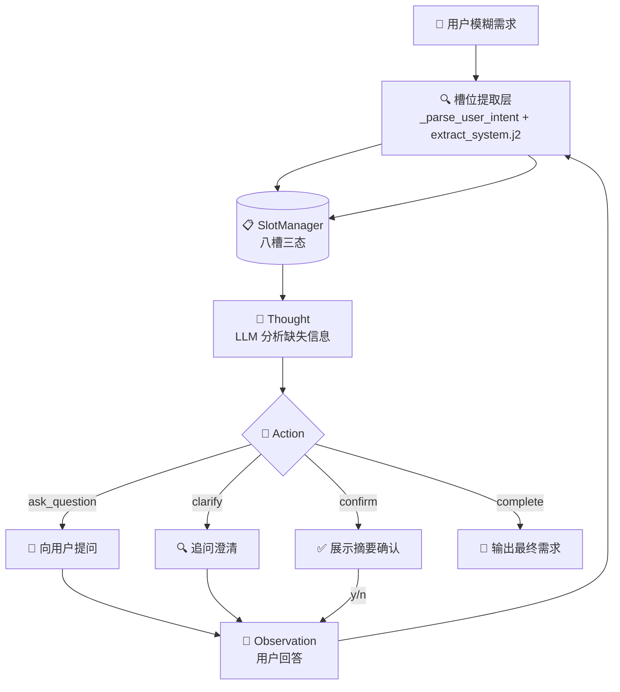
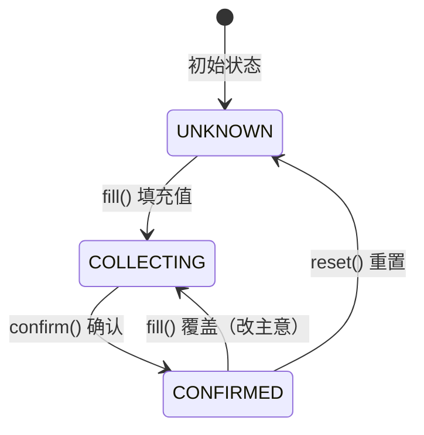

# 实验 6：ReAct 模式与需求理解智能体

> 对应章节 3.1 懂你所想：ReAct 与需求理解 ｜ 2 学时 ｜ ✅ 已完成

## 概述

本实验实现了一个**纯 ReAct（Thought → Action → Observation）** 驱动的行程需求收集智能体。用户只需一句模糊出行需求（如"我想出去玩几天"），智能体通过多轮交互逐步收集完整信息。

核心思路：

```
用户输入 → 槽位提取（首轮/每轮） → Thought（推理缺失信息）
    → Action（提问/澄清/确认/完成） → Observation（用户回答）
    → 回到 Thought……
```

**与常规 Function Calling 的区别**：本实验的所有 Action 都是面向用户的自然语言交互——问问题、澄清、确认——而非调用外部 API 或工具。这让学生直观理解 ReAct 的核心是"推理驱动行动"，而非仅"调用函数"。

## 功能清单

| 功能 | 命令                                       | 说明 |
|------|------------------------------------------|------|
| 交互式需求收集 | `python main.py`                         | 模糊需求 → 多轮追问 → 完整摘要 |
| 自定义追问上限 | `python main.py --max-iterations 10`     | 控制最大轮数，防止无限循环 |

### 智能体内部能力

| 能力 | 实现机制 | 说明 |
|------|---------|------|
| **槽位管理** | `SlotManager` 八槽三态模型 | UNKNOWN → COLLECTING → CONFIRMED |
| **ReAct 循环** | `TripRequirementCollector` T→A→O 引擎 | 每轮调用 LLM 做推理+行动决策 |
| **多槽位提取** | `_parse_user_intent()` 轻量 LLM 层 | 用户一句话带多个信息时自动拆解 |
| **动态适应** | `fill()` 返回覆盖标志 | 检测用户"改主意"，覆盖已确认槽位 |
| **终端可视化** | ASCII 面板实时刷新 | 8 槽状态一览，教学演示友好 |

## 文件结构

```
01-react-requirement/
├── config.yaml               # LLM 配置（API Key、模型、生成参数）
├── config.yaml.example       # 配置模板
├── requirements.txt          # 实验依赖
│
├── prompts/                                    # Jinja2 提示词模板
│   ├── agents/                                #   智能体提示词
│   │   └── trip_planning/                     #     行程规划智能体
│   │       └── requirement_collector/         #       需求收集器
│   │           ├── react_system.j2            #         ReAct 系统提示词
│   │           ├── react_user.j2              #         用户消息模板
│   │           ├── extract_system.j2          #         槽位提取系统提示词
│   │           └── extract_user.j2            #         槽位提取用户消息模板
│   └── memory/                                #   记忆相关模板
│
└── src/                      # 核心代码
    ├── main.py               #   CLI 入口（argparse + 交互循环）
    ├── config.py             #   Pydantic v2 配置模型
    ├── agents/               #   智能体组件
    │   └── trip_planning/    #     行程规划智能体
    │       ├── requirement_collector.py  #   需求收集器（T→A→O 驱动）
    │       ├── slot_manager.py          #   槽位管理器（八槽三态 + ASCII 面板）
    │       └── models/                 #   Pydantic 数据模型
    │           ├── __init__.py
    │           └── decision.py          #   ActionType / CollectionDecision / SlotValue / StepRecord
    └── inherit/              #   代码继承层（复用 ch02 的 LLMClient / PromptManager）
```

## 快速开始

### 1. 安装依赖

```bash
cd ch03-trip-agent/01-react-requirement
pip install -r requirements.txt
```

### 2. 配置 LLM

```bash
cp config.yaml.example config.yaml
# 编辑 config.yaml，填入 API Key
```

### 3. 运行

```bash
# 进入 src 目录运行
cd src
python main.py

# 自定义最大追问轮数
python main.py --max-iterations 8
```


## 对话效果

```
==================================================
  🧳 行程规划智能体 — 需求收集
  模型: deepseek-v4-flash @ https://api.deepseek.com
==================================================
  输入你的出行需求（越模糊越能体现 ReAct 模式！）
  示例："我想出去玩几天"
  输入 /quit 退出
==================================================

✈️  你的需求：我想去杭州玩几天，从北京出发

┌──────────────────────────────────────────────────┐
│  📋 需求信息收集面板                                      │
├──────────────────────┬────────────┬──────────────┤
│  目的地               │ 🔄 收集中    │ 杭州             │
│  出发城市              │ 🔄 收集中    │ 北京             │
│  出发日期              │ ⬜ 未询问    │ -              │
│  返回日期              │ ⬜ 未询问    │ -              │
│  预算                │ ⬜ 未询问    │ -              │
│  同行人数              │ ⬜ 未询问    │ -              │
│  偏好                │ ⬜ 未询问    │ -              │
│  约束条件              │ ⬜ 未询问    │ -              │
└──────────────────────┴────────────┴──────────────┘

========================================
  🔄 第 1 轮
========================================

💭 Thought: 已收集目的地和出发城市，但缺少出发日期和返回日期两个必需信息。
🎯 Action: ask_question

🤖 好的，您想去杭州，从北京出发。请问您打算哪天出发呢？
👤 8月1出发，5号回来，预算5000

┌──────────────────────────────────────────────────┐
│  📋 需求信息收集面板                                      │
├──────────────────────┬────────────┬──────────────┤
│  目的地               │ 🔄 收集中    │ 杭州             │
│  出发城市              │ 🔄 收集中    │ 北京             │
│  出发日期              │ 🔄 收集中    │ 8月1            │
│  返回日期              │ 🔄 收集中    │ 5号             │
│  预算                │ 🔄 收集中    │ 5000            │
│  同行人数              │ ⬜ 未询问    │ -              │
│  偏好                │ ⬜ 未询问    │ -              │
│  约束条件              │ ⬜ 未询问    │ -              │
└──────────────────────┴────────────┴──────────────┘

========================================
  🔄 第 2 轮
========================================

💭 Thought: 所有必需信息已齐全，预算也已了解。确认。
🎯 Action: confirm

🤖 好的，总结：8月1日从北京出发去杭州，8月5日返回，预算5000元。对吗？

以上需求是否正确？（y/n）
👤 y

✅ 需求收集完成！

========================================
  📋 最终需求摘要
========================================
  目的地 【必需】：杭州
  出发城市 【必需】：北京
  出发日期 【必需】：8月1
  返回日期 【必需】：5号
  预算 【可选】：5000
  同行人数 【可选】：（未指定）
  偏好 【可选】：（未指定）
  约束条件 【可选】：（未指定）
========================================
```


## 技术架构




## 核心模块说明

### 1. 槽位系统：八槽三态模型

`agents/trip_planning/slot_manager.py` — `SlotManager` 管理 8 个出行需求槽位，每个槽经历三种状态流转：



**八槽分类**：

| 类型 | 槽位 | 示例值 |
|------|------|--------|
| 必需（4 个） | destination, departure_city, start_date, end_date | "杭州"、"北京"、"8月1日"、"8月5日" |
| 可选（4 个） | budget, travelers, preferences, constraints | "5000"、"2人"、"美食"、"不坐红眼航班" |

**`SlotName` 枚举设计**：

```python
class SlotName(str, Enum):
    DESTINATION = "destination"       # 目的地
    DEPARTURE_CITY = "departure_city" # 出发城市
    START_DATE = "start_date"         # 出发日期
    END_DATE = "end_date"             # 返回日期
    BUDGET = "budget"                 # 预算（可选）
    TRAVELERS = "travelers"           # 同行人数（可选）
    PREFERENCES = "preferences"       # 偏好（可选）
    CONSTRAINTS = "constraints"       # 约束条件（可选）

    @property
    def label(self) -> str:  ...      # 中文标签
    @property
    def required(self) -> bool: ...   # 是否必需
```

**`fill()` 的动态适应**：

```python
def fill(self, name: SlotName, value: str) -> bool:
	"""填充槽位值。返回 True 表示覆盖了已确认值（用户改主意）。"""
	key = name.value
	if key not in self._slots:
		return False
	was_confirmed = self._slots[key].state == SlotState.CONFIRMED
	self._slots[key].value = value
	self._slots[key].state = SlotState.COLLECTING
	return was_confirmed  # ← 调用方据此判断"用户改了主意"
```

### 2. ReAct 循环引擎

`agents/trip_planning/requirement_collector.py` — `TripRequirementCollector` 驱动 Thought → Action → Observation 循环：

```python
def run(self, requirement: str) -> str:
	# 首轮：先从用户的初始输入中提取槽位
	intent = self._parse_user_intent(requirement)
	self._apply_intent(intent)
	self._render_panel()

	user_msg: str = requirement

	for iteration in range(1, self._max_iterations + 1):
		decision = self._think(user_msg)      # 1. Thought → Action
		observation = self._act(decision, iteration)  # 2. 执行 Action → Observation
		self._step_records.append(StepRecord(...))  # 3. 记录本轮
		if decision.action.type == ActionType.COMPLETE:  # 4. 终止检查
			return self._slot_manager.to_summary()
		user_msg = observation

	# 达到 max_iterations，强制结束
	return self._slot_manager.to_summary()
```

**四种 Action**：

| Action | 含义 | 触发条件 | 示例 |
|--------|------|---------|------|
| `ask_question` | 收集缺失信息 | 必需槽位未满 / 可选槽位值得问 | "请问哪天出发？" |
| `clarify` | 追问澄清 | 用户回答太模糊 | "8月1日是下周三还是某月？" |
| `confirm` | 确认需求 | 必需信息齐全 | "总结：北京→杭州，8.1-8.5" |
| `complete` | 结束收集 | 用户确认无误 | 输出最终摘要 |

### 3. 多槽位提取层

用户回答 A 问题时常常顺带提到 B/C/D 信息（如"8月1出发，5号回，预算5000"）。如果只用 ReAct 的 `target_slot` 字段逐一匹配，会遗漏大量信息。

**解决**：每次用户输入后，额外调度一次轻量 LLM 调用（`_parse_user_intent()` → `extract_system.j2` + `extract_user.j2`），将用户输入中的**所有**槽位信息一次性提取为 SlotValue 数组：

```json
[
  {"slot": "start_date", "value": "8月1日"},
  {"slot": "end_date", "value": "8月5日"},
  {"slot": "budget", "value": "5000元"}
]
```

然后在 `_apply_intent()` 中批量 fill。这保证了即使用户一次说很多信息，一个也不会丢。

### 4. 动态推理与决策

本实验的 ReAct 不是机械的"缺什么问什么"，而是通过提示词引导 LLM 做出**上下文感知的决策**：

| 机制 | 实现位置 | 说明 |
|------|---------|------|
| 重要性判断 | `…/react_system.j2` 原则 3 | 判断可选信息是否值得追问，不重要则跳过 |
| 改主意检测 | `fill()` 返回 `bool` | 已确认值被覆盖时触发警告，重新进入 COLLECTING |
| 否认后追问 | `…/react_system.j2` 原则 5 | 用户否认确认时，主动问具体需要改什么 |
| 避免过度追问 | `…/react_system.j2` 原则 4 | 确认时严禁同时追问新的可选信息 |

### 5. 提示词设计

四套 Jinja2 模板协同工作：

| 模板 | 调用频率 | 作用 |
|------|---------|------|
| `…/react_system.j2` | 每轮 1 次 | 定义分析师角色 + 8 槽位 + 4 Action + 收集原则（含日期处理规则） |
| `…/react_user.j2` | 每轮 1 次 | 注入当前槽位上下文 + ReAct 步骤记录 + 本轮消息 |
| `…/extract_system.j2` | 每次用户输入 1 次 | slot_value_schema 注入 + 提取规则（独立 LLM 调用） |
| `…/extract_user.j2` | 每次用户输入 1 次 | 注入槽位上下文 + conversation_history + user_input |

`agents/trip_planning/requirement_collector/react_system.j2` 的收集原则：

1. 优先收集必需信息，再收集可选信息
2. 每次只问一个问题
3. 判断可选信息的重要性再决定是否追问
4. 确认时**严禁**同时追问新的可选信息
5. 用户否认确认时，主动问具体需要改什么
6. 先听后问：用户可能一句话包含多条信息，仔细识别不重复提问
7. 动态适应：用户可能改变主意，检测并重新收集被修改的槽位


## 终端演示

```bash
$ cd src && python agents/trip_planning/slot_manager.py
```

```
┌──────────────────────────────────────────────────┐
│  📋 需求信息收集面板                                      │
├──────────────────────┬────────────┬──────────────┤
│  目的地               │ ⬜ 未询问    │ -              │
│  出发城市              │ ⬜ 未询问    │ -              │
│  出发日期              │ ⬜ 未询问    │ -              │
│  返回日期              │ ⬜ 未询问    │ -              │
│  预算                │ ⬜ 未询问    │ -              │
│  同行人数              │ ⬜ 未询问    │ -              │
│  偏好                │ ⬜ 未询问    │ -              │
│  约束条件              │ ⬜ 未询问    │ -              │
└──────────────────────┴────────────┴──────────────┘
```
