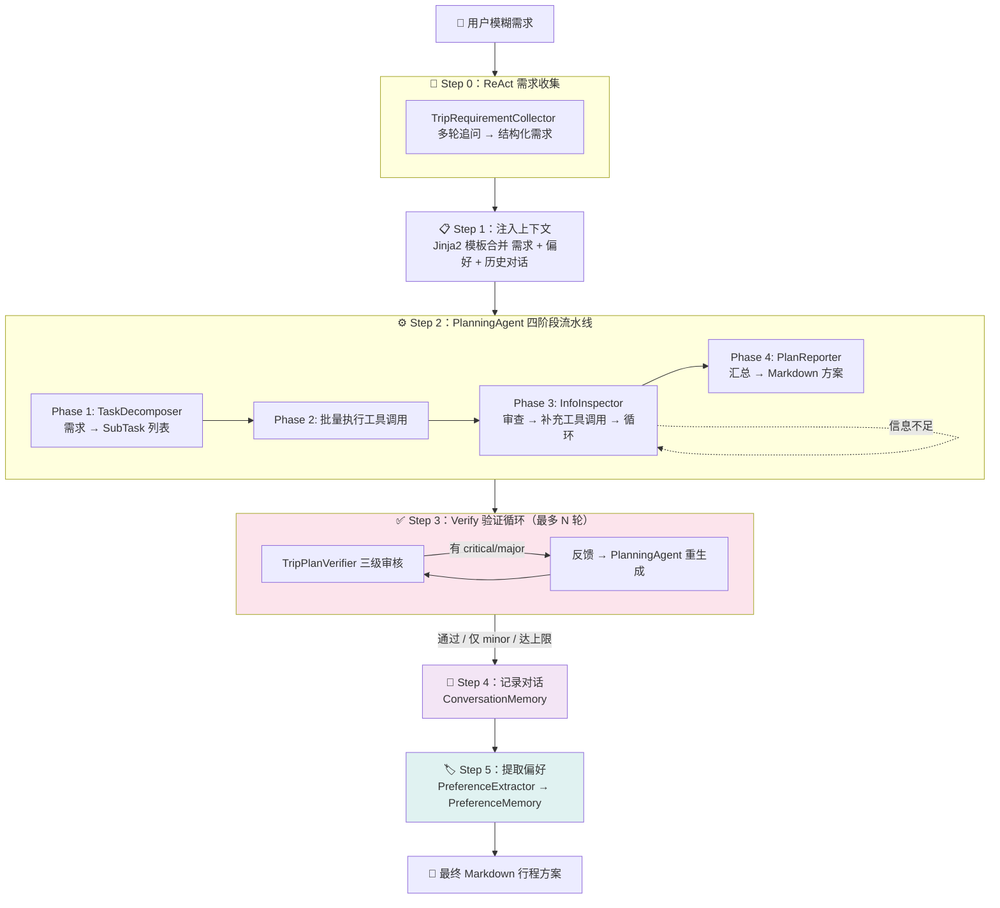
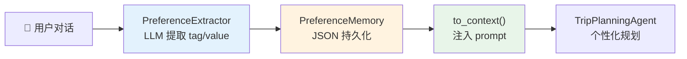

# 实验 8：行程规划智能体综合实践

> 对应章节 3.3 实战：行程规划智能体 ｜ 2 学时 ｜ ✅ 已完成

## 概述

本实验将实验 6（ReAct 需求理解）和实验 7（任务分解与工具编排）**整合为一个完整的 Collect→Plan→Execute→Verify 闭环系统**，并新增**个性化记忆**与**方案验证**两大能力：

- **Collect**：ReAct 驱动的多轮需求收集（来自实验 6）
- **Plan + Execute**：PlanningAgent 驱动 Decompose→Execute→Inspect→Report 四阶段流水线（来自实验 7）
- **Verify**：TripPlanVerifier 三级（critical / major / minor）方案审核 + 反馈重生成
- **Memory**：跨会话用户偏好记忆（PreferenceMemory）+ 对话历史注入（ConversationMemory）

一句话概括：**用户只需一句模糊出行需求，智能体全程自主运作，输出一份经过验证的个性化行程方案。**

## 功能清单

| 功能 | 说明 |
|------|------|
| ReAct 需求收集 | 多轮交互，自动识别缺失信息并追问（继承实验 6） |
| 任务分解与编排 | Decompose→Execute→Inspect→Report 四阶段流水线（继承实验 7） |
| **方案验证闭环** | LLM 从时间冲突 / 地理一致性 / 预算合理性 / 逻辑完整性四维度审核，不通过则反馈至 PlanningAgent 重生成 |
| **用户偏好记忆** | PreferenceExtractor 自动从对话中提取 tag/value 偏好标签，PreferenceMemory JSON 持久化，跨会话复用 |
| **对话历史注入** | ConversationMemory 记录前序会话，合并偏好上下文后通过 Jinja2 模板注入 prompt |

### 与实验 6、实验 7 的关系

```
实验 6（ReAct 需求理解）              实验 7（任务分解与工具编排）
         │                                         │
         │  TripRequirementCollector                │  PlanningAgent
         │  (多轮追问 → 结构化需求)                   │  (Decompose→Execute→Inspect→Report)
         │                                         │
         └───────────────┬─────────────────────────┘
                         ▼
               实验 8（综合实践 — 本实验）
               ├── TripPlanningAgent：统一入口，5 步闭环（Step 0-5）
               ├── TripPlanVerifier：方案验证（新增）
               ├── PreferenceExtractor：偏好提取（新增）
               ├── PreferenceMemory：偏好持久化（新增）
               └── ConversationMemory：对话记忆（继承自 ch02）
```

## 文件结构

```
03-integration/
├── config.yaml               # LLM 配置（API Key、模型、生成参数）
├── config.yaml.example       # 配置模板（复制为 config.yaml 后填入密钥）
├── requirements.txt          # 实验依赖（openai / PyYAML / pydantic / jinja2）
│
├── data/
│   └── memories/             #   ★ 会话记忆 + 偏好存储（JSON）
│
├── docs/
│   └── 教案讲课稿.md          #   教学用讲课稿（含课堂演示代码）
│
├── output/                   #   行程方案输出
│   └── trip_plan_*.md        #     自动生成的时间戳文件名
│
├── prompts/                  #   Jinja2 提示词模板
│   └── agents/
│       ├── planning/         #     规划智能体 prompt（继承实验 7）
│       │   ├── task_decomposer/  #   system.j2 + decompose.j2
│       │   ├── info_inspector/   #   system.j2 + inspect.j2
│       │   └── plan_reporter/    #   system.j2 + report.j2
│       ├── trip_planning/    #     行程领域 prompt
│       │   ├── plan_verifier/    # ★ 方案验证（system.j2 + verify.j2）
│       │   ├── preference_extractor/  # ★ 偏好提取（system.j2 + extract.j2）
│       │   ├── requirement_collector/ # ReAct 需求收集（继承实验 6）
│       │   ├── requirements_context.j2  # ★ 上下文注入模板
│       │   └── regenerate_context.j2    # ★ 重生成反馈模板
│
├── src/                      #   核心代码
│   ├── main.py               #     CLI 入口（parse_args → build_agent → plan_loop）
│   ├── config.py             #     Pydantic v2 配置模型
│   │
│   ├── agents/               #   ★ 本实验新增的 Agent 模块
│   │   ├── trip_planning/    #     ★ 行程规划
│   │   │   ├── trip_planning_agent.py   # TripPlanningAgent：统一入口，5 步闭环
│   │   │   └── trip_plan_verifier.py    # TripPlanVerifier：三级严重度 + 结构化审核
│   │   └── preference_extractor/  # ★ 偏好提取
│   │       └── preference_extractor.py # PreferenceExtractor：LLM 从对话中提炼 tag/value
│   │
│   ├── memory/               #   ★ 偏好记忆持久化
│   │   └── preference_memory.py  # PreferenceEntry + PreferenceMemory（JSON 文件 CRUD）
│   │
│   └── inherit/              #   代码继承层（来自 ch02 + ch03/01 + ch03/02，严禁修改）
│       ├── agents/
│       │   ├── planning/     #     PlanningAgent / TaskDecomposer / InfoInspector / PlanReporter
│       │   └── trip_planning/  #   TripRequirementCollector / domain_context / 工具（mock）
│       ├── llm/              #     LLMClient（含 chat_with_json）/ ToolRegistry
│       ├── prompt/           #     PromptManager（Jinja2 模板管理器）
│       ├── memory/           #     ConversationMemory（对话记忆 + 自动压缩）
│       ├── tools/            #     TavilySearch（真实网络搜索）
│       └── utils/            #     项目路径 + 模型渲染（render_model_code）
│
└── tests/                    #   测试代码
```

## 快速开始

### 1. 安装依赖

```bash
cd ch03-trip-agent/03-integration
pip install -r requirements.txt
```

依赖包：

| 包名 | 用途 |
|------|------|
| `openai` | LLM API 调用（兼容 DeepSeek 等） |
| `PyYAML` | 解析配置文件 |
| `pydantic` | 数据模型校验（v2，`model_validate_json`） |
| `jinja2` | 提示词模板渲染 |

### 2. 配置 LLM

```bash
cp config.yaml.example config.yaml
```

编辑 `config.yaml`，填入 API Key：

```yaml
llm:
  provider: "deepseek"
  base_url: "https://api.deepseek.com"
  model: "deepseek-v4-flash"
  api_key_env: "sk-..."

generation:
  temperature: 0.8
  top_p: 0.95
  max_tokens: 4096

tavily:
  api_key: "your-tavily-api-key-here"
  max_results: 5
  include_answer: false
```

### 3. 运行

```bash
# 进入 src 目录运行
cd src

# 交互式出行规划
python main.py

# 限制验证-重生成最多 5 轮（默认 3）
python main.py --max-verify 5

# 限制审查循环最多 3 轮（默认 5）
python main.py --max-inspect 3

# 指定输出文件
python main.py -o output/chengdu_trip.md
```

交互示例：

```
==================================================
  🧳 行程规划智能体 — Collect→Plan→Execute→Verify 闭环
  模型: deepseek-v4-flash
  工具: flight_search, hotel_search, attraction_search, weather_query
==================================================
  输入你的出行需求
  输入 /quit 退出
==================================================

✈️  需求：我想去成都玩，北京出发，8月5号到9号，预算8000

🧠 Step 0：需求智能收集
	📋 收集完成
	（ReAct 多轮追问后确定完整需求...）

📋 Step 1：注入上下文
	📌 已加载用户偏好（3 条）
	📌 已加载历史对话（5 轮）

⚙️ Step 2：方案生成
📋 Phase 1：任务分解
🔧 Phase 2：执行初始任务
🔄 Phase 3：审查与补充
📝 Phase 4：方案生成

✅ Step 3：方案验证
	✅ 第 1/3 轮
		✅ 通过

💾 Step 4：记录对话

🏷️ Step 5：提取偏好
	📌 已提取用户偏好：饮食偏好=川菜, 酒店风格=商务型

===================================================
（完整 Markdown 行程方案）

📁 行程已保存至：output/trip_plan_20260720_143022.md

🔁 再来一次？（y/n）：
```

## 架构设计

### Collect→Plan→Execute→Verify 闭环



### 方案验证的三级严重度

| 级别 | 标记 | 含义 | 处理方式 |
|------|------|------|---------|
| **critical** | 🔴 | 致命问题（如时间冲突、地理不可能） | 触发重生成 |
| **major** | 🟡 | 重要问题（如预算超支、缺少关键信息） | 触发重生成 |
| **minor** | 🟢 | 轻微问题（如措辞不当、格式不统一） | 接受方案，不触发重生成 |

`TripPlanVerifier.verify()` 返回 `VerifyResult`，通过 `has_critical_or_major()` 判断是否需要修复。验证循环有三个退出条件：

1. `is_valid = True` → 方案通过
2. 仅存在 minor 级别问题 → 接受方案
3. 达到 `max_verify_rounds` 上限 → 强制返回

### 偏好记忆系统



## 核心模块说明

### 1. TripPlanningAgent —— 统一入口

`src/agents/trip_planning/trip_planning_agent.py` 是整个系统的编排中心。它**不自己做推理、不调工具、不生成文本**——唯一职责是协调各子模块按顺序执行。

```python
class TripPlanningAgent:
    def __init__(
        self,
        llm: LLMClient,
        pm: PromptManager,
        registry: ToolRegistry,
        conversation_memory: ConversationMemory,
        preference_memory: PreferenceMemory,
        max_verify_rounds: int = 3,
        max_inspect_rounds: int = 5,
        verbose: bool = True,
    ) -> None: ...
```

内部自动构建以下子模块：

| 子模块 | 类 | 来源 |
|--------|-----|------|
| 需求收集器 | `TripRequirementCollector` | 实验 6（inherit） |
| 规划智能体 | `PlanningAgent` | 实验 7（inherit） |
| 方案验证器 | `TripPlanVerifier` | 本实验新增 |
| 偏好提取器 | `PreferenceExtractor` | 本实验新增 |

`run()` 方法执行 5 步闭环（Step 0-5）：

```python
def run(self, requirements: str) -> str:
    # Step 0: ReAct 需求收集 — TripRequirementCollector 多轮追问
    requirements = self._requirement_collector.run(requirements)

    # Step 1: 注入上下文 — 用 Jinja2 模板合并偏好 + 历史对话
    requirements = self._pm.render(
        "agents/trip_planning/requirements_context.j2",
        requirements=requirements,
        preferences=self._pref_mgr.get_preferences(),
        history_messages=self._conv_mem.get_messages(),
    )

    # Step 2: PlanningAgent 编排 — Decompose→Execute→Inspect→Report
    plan_text = self._planner.run(
        requirements=requirements,
        domain_context=TRIP_DECOMPOSE_CONTEXT,
        inspection_domain_context=TRIP_REFLECT_CONTEXT,
        plan_domain_context=TRIP_PLAN_CONTEXT,
    )

    # Step 3: Verify 验证循环 — 不通过则反馈重生成（最多 max_verify_rounds 轮）
    for round_num in range(1, self._max_verify_rounds + 1):
        result = self._verifier.verify(requirements, plan_text)
        if result.is_valid or not result.has_critical_or_major():
            break
        # 构造反馈 → PlanningAgent 重生成
        regenerate_context = self._pm.render(
            "agents/trip_planning/regenerate_context.j2", ...)
        plan_text = self._planner.run(..., plan_domain_context=regenerate_context)

    # Step 4: 记录本轮对话
    self._conv_mem.record_turn(requirements, plan_text)

    # Step 5: 提取偏好并持久化
    for entry in self._pref_extractor.extract(requirements):
        self._pref_mgr.record_preference(entry.tag, entry.value)

    return plan_text
```

### 2. TripPlanVerifier —— 方案验证

`src/agents/trip_planning/trip_plan_verifier.py` 从四个维度审核行程方案：

| 审核维度 | 检查内容 | 示例 |
|---------|---------|------|
| 时间冲突 | 同一天多个景点时间是否重叠 | 东方明珠 09:30-11:30 与外滩 09:00-10:00 冲突 |
| 地理一致性 | 景点是否在目的地合理范围内 | 成都出发去九寨沟需 8 小时，不适合 3 天行程 |
| 预算合理性 | 各项花费加总是否在预算内 | 迪士尼 500 + 住宿 300 = 剩余 200 不够餐费 |
| 逻辑完整性 | 是否遗漏关键环节 | 有去程航班但无回程，天气仅覆盖部分日期 |

数据模型：

```python
class Severity(StrEnum):
    CRITICAL = "critical"  # 🔴 致命
    MAJOR = "major"        # 🟡 重要
    MINOR = "minor"        # 🟢 轻微

class VerifyIssue(BaseModel):
    dimension: str       # 所属维度
    severity: Severity   # 严重程度
    description: str     # 具体描述

class VerifyResult(BaseModel):
    is_valid: bool
    issues: list[VerifyIssue]
    suggestions: list[str]
    reasoning: str

    def has_critical_or_major(self) -> bool: ...
```

`verify()` 方法以 `temperature=0.2` 调用 LLM（低温度确保审核一致性），返回结构化的 `VerifyResult`。

### 3. 偏好记忆系统

由两个模块协作，实现跨会话的个性化：

**PreferenceExtractor**（`src/agents/preference_extractor/preference_extractor.py`）：

- `extract(user_message: str) → list[PreferenceEntry]`
- 以 `temperature=0.1` 调用 LLM，从用户消息中自动提炼偏好
- 区分"偏好"和"事实"：`酒店风格=商务型`（偏好，跨会话有效）vs `目的地=成都`（事实，仅本次有效）

**PreferenceMemory**（`src/memory/preference_memory.py`）：

- `PreferenceEntry(BaseModel)`：`tag` / `value` / `updated_at` 三个字段
- `record_preference(tag, value)`：记录/更新偏好（tag 已存在则覆盖）
- `to_context()`：生成可注入 prompt 的偏好描述文本
- JSON 文件持久化：`data/memories/trip_agent_preferences.json`

存储示例：

```json
{
    "preferences": [
        {"tag": "酒店风格", "value": "商务型", "updated_at": "2026-07-20T14:32:00"},
        {"tag": "饮食偏好", "value": "川菜/辣味", "updated_at": "2026-07-20T14:32:00"}
    ]
}
```

### 4. main.py CLI

`src/main.py` 提供交互式命令行入口，包含三个函数：

| 函数 | 职责 |
|------|------|
| `parse_args()` | 解析 CLI 参数：`--max-verify`（默认 3）、`--max-inspect`（默认 5）、`-o/--output` |
| `build_agent(cfg, pm, max_verify_rounds, max_inspect_rounds)` | 构建 LLMClient + ToolRegistry + ConversationMemory + PreferenceMemory + TripPlanningAgent |
| `plan_loop(agent, output_file)` | 交互式输入 → `agent.run()` → 输出方案 → 询问是否继续 |

注册的工具：`flight_search`、`hotel_search`、`attraction_search`、`weather_query`，以及可选的 `web_search`（需 Tavily API Key）。

